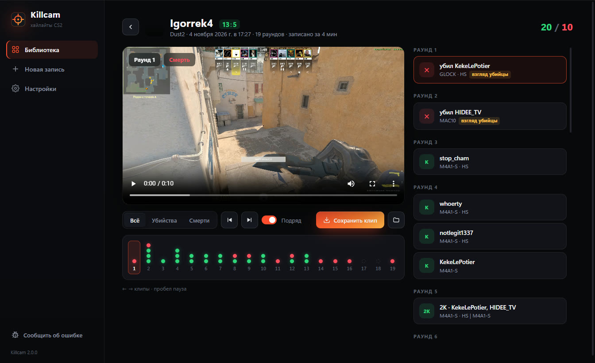

<p align="center"></p>

<h1 align="center">Killcam</h1>
<p align="center"><b>Каждый фраг — своими глазами.</b><br>Хайлайты из демок CS2: все убийства и смерти игрока от первого лица, повтор глазами убийцы, по раундам.</p>

<p align="center">
  <a href="https://github.com/evgenstepanov998-afk/killcam/releases/latest/download/KillcamSetup.exe"><b>⬇ Скачать для Windows</b></a> ·
  <a href="https://evgenstepanov998-afk.github.io/killcam/">Сайт</a> ·
  <a href="https://discord.gg/SJjt7sdMVn">Discord</a>
</p>



## Как пользоваться

1. Скачай и установи `KillcamSetup.exe`. Если Windows покажет «Система Windows защитила ваш компьютер» — «Подробнее» → «Выполнить в любом случае».
2. При первом запуске прими условия — Killcam скачает HLAE и ffmpeg (~130 МБ, один раз).
3. Перетащи демку (`.dem`, `.dem.gz`, `.dem.zst`) → выбери игрока → **Записать**. Первые клипы — через минуту, весь матч — ~3 минуты.

## Что Killcam делает на компьютере

- Запускает отдельную CS2 через [HLAE](https://www.advancedfx.org/) в режиме `-insecure` (без VAC) — только чтобы проиграть демку.
- На время записи ставит минимальную графику и возвращает твои настройки сразу после.
- Прячет окно CS2 и выключает её звук в микшере Windows.
- Хранит клипы в `Документы\Killcam`. Ничего не загружает, кроме отчёта об ошибке, если ты сам нажмёшь «Сообщить об ошибке».
- Раз при запуске проверяет обновления на GitHub (можно выключить в настройках).

## Сборка

```powershell
pip install -r requirements.txt pyinstaller
.\build.ps1          # → dist\KillcamSetup.exe (нужен Inno Setup 6)
```

Без сборки: `python killcam.py`.

---
Не связан с Valve. Counter-Strike — товарный знак Valve Corporation.
